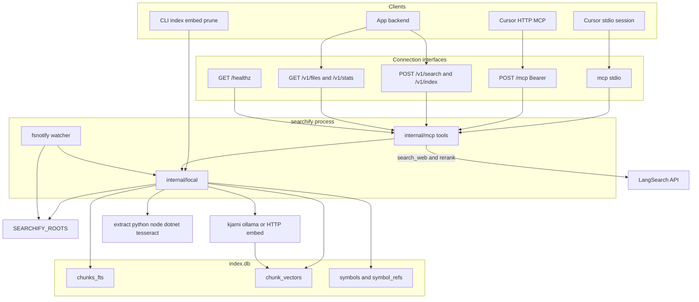

# Searchify architecture

Hybrid text-search MCP server in Go.

## Overview

One process exposes MCP (stdio or Streamable HTTP) and REST. Agents and app backends call those interfaces; the CLI and optional file watcher write the same SQLite index. `/healthz` is unauthenticated; `/mcp` and `/v1/*` require `Authorization: Bearer` matching `SEARCHIFY_HTTP_TOKEN`. The watcher starts only when `SEARCHIFY_WATCH_PATHS` is set (incremental changes under those paths — not a full-tree re-index).

## Components

| Layer | Package | Role |
|-------|---------|------|
| CLI | `cmd/searchify` | `mcp stdio`, `serve http`, `index` subcommands |
| MCP | `internal/mcp` | Tool registration; stdio + Streamable HTTP |
| Config | `internal/config` | Env vars, path allowlist |
| File search | `internal/file` | Single-file keyword scan |
| Local index | `internal/local` | SQLite FTS5 + chunk vectors (phase 2–3) |
| Code analyze | `internal/code` | Language Analyzer plugins (Python AST worker; Go `go/parser`; TS/JS Node worker; C# Roslyn-or-heuristic) |
| Web | `internal/web` | LangSearch web search + shared HTTP client (phase 4) |
| Rank | `internal/rank` | RRF fusion; rerank delegates to `internal/web` (phase 3–4) |

## Storage (phase 2–3)

- Index database: `{SEARCHIFY_INDEX_DIR}/index.db`
- Lexical: SQLite FTS5 via `modernc.org/sqlite` (pure Go)
- Vectors: `chunk_vectors` table (float32 embeddings from kjarni-go)
- Code: schema v4 `chunk_symbols`, `symbols`, `symbol_refs` (see [ADR 001](./adr/001-code-symbols.md))
- Embeddings: in-process via `SEARCHIFY_EMBED_MODEL` (default `minilm-l6-v2`)
- Incremental updates keyed on file `mtime` + `size`; vectors updated with re-indexed files

## MCP tools

| Tool | Phase | Description |
|------|-------|-------------|
| `search_file` | 1 | Keyword search in one file |
| `index_status` | 1 | Index readiness and config |
| `index_paths` | 2 | Build/update local index |
| `remove_paths` | opt | Remove files/dirs from index (FTS + vectors) |
| `index_prune` | opt | Drop orphans missing on disk / outside roots |
| `search_local` | 2–3 | Query persisted index |
| `lookup_symbol` | opt | Code symbol definitions (Python v1) |
| `find_references` | opt | Best-effort code refs (Python v1) |
| `search_web` | 4 | Internet search via LangSearch |

## Web search (phase 4)

- Client: `internal/web.Client` (shared by `search_web` and local rerank)
- Endpoint: `POST https://api.langsearch.com/v1/web-search`
- In-memory TTL cache (~15 minutes, max 128 entries)
- HTTP 429: exponential backoff with jitter (up to 3 retries)

## Search modes

- **keyword** — FTS5 BM25 over `chunks_fts`. `buildFTSQuery` splits on whitespace, strips surrounding quotes per token, and joins terms with **`AND`**. Every term must appear in the **same chunk** (order and adjacency do not matter). The word `OR` is a literal token, not a boolean operator. Quoted phrases are not preserved today.
- **vector** — embed the full query string once; rank chunks by cosine similarity. No token AND/OR; near-paraphrases can rank without sharing all query words.
- **hybrid** — keyword and vector legs in parallel, then RRF fusion. Prefer hybrid when `index_status.vector_ready` is true (`vector_chunk_count == chunk_count`). Prefer **keyword-only** when vectors are incomplete — a sparse vector leg pulls noise into RRF.

**Guidance:** do not add boolean query syntax for routine use. Hybrid (when vectors are complete) covers exact tokens plus semantic near-matches. To survey **alternate names** that need not co-occur (true OR), run separate keyword calls and merge paths, or wait for optional `term_op` ([`opt-term-op`](./feature-backlog.md)). Check readiness with MCP `index_status` (`vector_ready`, or compare `vector_chunk_count` to `chunk_count`).

### Path allow-set (constrained retrieve)

Planned: [`opt-search-path-allowset`](./feature-backlog.md). Groundline (and similar ACL-owning clients) resolve **who** the caller is and **what** they may see. Searchify only **ranks inside that allow-set**. Searchify must not implement identity or ACL policy (no users, roles, AD, JWTs, tenant model, or Groundline auth integration).

**Why:** if Searchify returns a global top-`limit` and the client filters afterward, allowed documents that ranked just outside `k` are dropped → result starvation (empty/weak evidence even when readable matches exist).

**Contract** (additive; omit both fields = current unscoped search):

| Field | Semantics |
|-------|-----------|
| `path_prefixes: string[]` | Hit path equals or is under any prefix (OR). Path-segment prefix, not a raw string prefix (`/docs` must not match `/docs-private`). |
| `paths: string[]` | Optional exact-path allow-list, OR’d with prefixes (union if both set). |

Same fields on `POST /v1/search` and MCP `search_local` (REST already goes through `executeSearchLocal`). Relative paths resolve like other APIs (`SEARCHIFY_PATH_BASE`, then roots). Every resolved path must stay under `SEARCHIFY_ROOTS`; invalid or out-of-root entries → **400**.

**Presence vs empty:**

- Both fields omitted → unscoped (today).
- Either field present and the union of prefixes + exact paths is empty → **200** + `results: []`. Do **not** fall back to the full index.
- Constraint applies in the keyword, vector, and hybrid legs **before** scoring/fusion/top-`limit`. Hybrid RRF runs over the filtered legs. Return up to `limit` from the constrained set.

**Non-goals:** tenant/user/role model; Groundline auth; post-gen / LLM / audit logic; changing default unscoped search when filter fields are omitted.

**Groundline alignment:** when trim is enabled, Groundline sends the resolved allow-set and will not post-filter a global top-`k` as the primary design. Empty allow-set → Groundline refuses without calling Searchify unscoped. Searchify still returns `[]` if invoked with a present-empty set (defense in depth).

**Acceptance:**

- A relevant doc under an allowed prefix is returned; a stronger match outside the prefixes is not.
- With a small allow-set, `limit` is filled from allowed docs when they exist (proves no post-trim starvation).
- Unscoped `POST /v1/search` (fields omitted) is unchanged.
- Tests cover `keyword` and `hybrid` with `path_prefixes`.

## External APIs

- [LangSearch Web Search](https://docs.langsearch.com/api/web-search-api)
- [LangSearch Semantic Rerank](https://docs.langsearch.com/api/semantic-rerank-api)

## HTTP transport (phase 5)

- CLI: `searchify serve http [--addr] [--path]`
- go-sdk `NewStreamableHTTPHandler` with **stateless** sessions
- Auth: `Authorization: Bearer` must match `SEARCHIFY_HTTP_TOKEN` (required to start)
- Probes: `GET /healthz` (no auth)
- Timeouts: `ReadHeaderTimeout` 5s; ~60s request budget
- TLS: not terminated in-process — put a reverse proxy in front when exposing beyond localhost (see backlog `opt-tls-reverse-proxy`)
- App integration: MCP Streamable HTTP plus REST `POST /v1/search`, `POST /v1/index`, `GET /v1/files`, `GET /v1/stats` (same Bearer token); optional REST remove later
- Index inventory: MCP `list_indexed_files` / REST `GET /v1/files`; MCP `index_stats` / REST `GET /v1/stats` (`file_count`, `folder_count`, `vector_chunk_count`, `total_bytes`, `last_index_change`)
- Deletions: MCP/CLI `remove_paths` / `searchify remove`; reconcile orphans with `index_prune` / `searchify prune` (`opt-index-prune`)
- Auto-index: optional `SEARCHIFY_WATCH_PATHS` fsnotify (+ optional `SEARCHIFY_WATCH_RESCAN`) starts with `mcp stdio` / `serve http`
- Path UX: relative paths resolve via `SEARCHIFY_PATH_BASE` then roots (no process CWD); absolute paths must stay under roots. Nested `SEARCHIFY_ROOTS` entries are collapsed to outermost roots so the same tree is not walked twice.
- Snippets: default max is `SEARCHIFY_SNIPPET_CHARS` (300); per-query `snippet_max` on `search_local` / `POST /v1/search` (hard cap 8000)
- PDF pages: extract inserts form-feeds between pages (`pdftotext`, Go PDF fallback, OCR). Chunker stores 1-based `page` in `chunk_pages` (schema v3). Search hits expose optional `page` and title `file.pdf:p.N` when known; markdown/code keep `file:line`.
- PPTX / ODP: same `\f` + `page` path — one unit per slide (`deck.pptx:p.2`). ODT/ODS unchanged (no slide/page markers).
- File types: pluggable extractors (`internal/extract`) index passthrough text/code plus PDF/DOCX/XLSX/CSV/HTML (and stretch PPTX/ODF/RTF/EML). Images and scanned-PDF OCR are optional via `SEARCHIFY_OCR` (Tesseract on `PATH`; `pdftoppm` for PDF OCR). Memory: `SEARCHIFY_MAX_FILE_BYTES` (default 2 MiB), extract/chunk caps, `SEARCHIFY_EMBED_BATCH` (default 1), `SEARCHIFY_EMBED_BACKEND` (`process` default / `onnx` / `none`), `SEARCHIFY_SKIP_EMBED` for FTS-only ingest, `SEARCHIFY_EMBED_RELOAD` (default on) when using in-process ONNX. See `opt-richer-file-types` (#24), `opt-embed-worker` (#36)
- Observability: search/index tool responses include `duration_ms`; `search_local` adds per-leg `timing` (backlog was `opt-timing-metrics`)

## Optional scale

- **Embedding memory (`opt-embed-worker`):** in-process kjarni→ONNX can pin multi-GB native RSS (outside Go GC). Default `SEARCHIFY_EMBED_BACKEND=process`: index writes FTS then spawns short-lived `searchify embed --file` so the parent never loads ONNX and the OS reclaims worker RSS on exit. `onnx` keeps legacy in-process embeds (+ `SEARCHIFY_EMBED_RELOAD`). `none` / `SEARCHIFY_SKIP_EMBED` / `index --skip-embed` stay FTS-only; backfill with `searchify embed`. Keep `mode=keyword` first-class.
- **Embedding quality (`opt-better-embeddings`):** `SEARCHIFY_EMBED_MODEL` selects a kjarni model — `minilm-l6-v2` (384-d, default), `mpnet-base-v2` / `distilbert-base` (768-d). Unknown names fail at config load. Switching models clears `chunk_vectors` on the next embed/index write and vector search refuses mismatched meta until `searchify embed --force` (or re-index). Process/skip-embed backends unchanged. No multilingual embed in kjarni today.
- **Embed engine adapter (`opt-embed-engine-adapter`):** `SEARCHIFY_EMBED_ENGINE=kjarni|ollama|http` selects the vector factory (`Embedder`). Kjarni remains default (allowlisted models). Ollama calls `POST {SEARCHIFY_EMBED_URL}/api/embed` (default `http://127.0.0.1:11434`). HTTP posts `{"model","input"}` to a full URL. Meta stores `embed_engine` + `embed_model`; mismatch clears vectors on write and fails vector search until `embed --force`. `SEARCHIFY_EMBED_BACKEND` still means *where* embeds run.
- **Chunking quality (`opt-better-chunking`):** `SEARCHIFY_CHUNK_BYTES` (default 3072) and `SEARCHIFY_CHUNK_OVERLAP` (default 256) pack extracted text. Hard boundaries: Markdown ATX headings, form-feed `\f` (PDF pages), blank-line paragraphs; oversized units hard-split. Changing chunk settings needs `searchify index --force` (+ embed refresh). Cap still `SEARCHIFY_MAX_CHUNKS_PER_FILE`.
- **Index excludes:** walks and the file watcher skip dependency directories by name (`node_modules`, `site-packages`, `bin`, `venv`, `.venv`, `.yarn`, …). `SEARCHIFY_EXCLUDE_DIRS` adds exact names, single-segment globs, or path patterns (`python*/site-packages`, `**/third_party`). `SEARCHIFY_EXCLUDE_FILES` skips file base names (`go.sum`, `*.min.js`); it does not match paths. `searchify prune` drops rows already stored under those directories or file names.
- **Code symbols (`opt-code-symbols`):** language `Analyzer` plugins; Python AST worker (`python3` on PATH, fail-soft to text chunks); **Go** via `go/parser` in-process (`opt-code-symbols-go`); **TypeScript/JS** via Node worker (`opt-code-symbols-ts`, prefers project `typescript`, else heuristic); **C#** via Roslyn worker when `dotnet` is on PATH, else in-process heuristic (`opt-code-symbols-csharp`); schema v4 `chunk_symbols` / `symbols` / `symbol_refs`; MCP `lookup_symbol` / `find_references`; `search_local` may include `symbol` / `symbol_kind`. See [ADR 001](./adr/001-code-symbols.md). Re-index code trees with `--force` after upgrade.
- **Extract memory:** PDF/Office/HTML parsers (especially `ledongthuc/pdf`) can hang or spike multi-GB heap on some real-world PDFs. Default: index spawns short-lived `searchify extract --file` for non-passthrough types; PDF prefers **`pdftotext`** (Poppler) when on `PATH`, else page-loop Go parser; extract timeouts become **skip** so the rest of the corpus continues (`SEARCHIFY_EXTRACT_INPROCESS=1` restores old in-process behavior).
- **Bulk ingestion:** the watcher drains events separately from one indexing worker. Its per-path debounce map is capped at 1,024 paths, with a single wake channel/timer; excess events coalesce into a recovery scan. Startup, queue overflow, fsnotify overflow, and optional periodic scans reconcile missing files in 128-row pages and attach watches before streaming an incremental index pass. New directory attachment/crawling happens in the worker. Directory reads use 128-entry batches; index progress totals use a count pass rather than retaining all paths. Indexing and embedding share a service-local gate, including API calls; request cancellation stops queued indexing/discovery/extraction and process embedding workers. Shutdown cancels and joins the watcher before database close. This is not a cross-process resource limit or a hard RSS cap for individual models/parsers.
- Vector search is brute-force cosine today; ANN/HNSW is optional when corpora grow (backlog `opt-hnsw-vectors`)
- Keyword boolean / FTS5 exact phrases are not exposed; optional `term_op` + preserved `"..."` phrases is backlog `opt-term-op`. Matching `search_file` phrase (contiguous substring) is backlog `opt-search-file-phrase` (separate line scanner, not FTS5).
- Constrained retrieve by caller-supplied path allow-set (`path_prefixes` / `paths`) is backlog [`opt-search-path-allowset`](./feature-backlog.md) — see [Path allow-set](#path-allow-set-constrained-retrieve).
- Storage stays SQLite FTS5 + blob vectors by default; optional store adapter (backlog `opt-store-adapter`) would select backend via config (e.g. `SEARCHIFY_STORE=sqlite|postgres`) so PostgreSQL + pgvector can replace the local DB without changing MCP tools
- **Postgres hosting decision:** when `opt-store-adapter` lands, prefer the **same Postgres instance as Groundline** on a given host (shared server, Searchify-owned schema/database or prefixed tables)—do not run a second Postgres solely for Searchify unless isolation requirements force it. Connection via env (DSN) pointing at that shared instance.

## Environment

See [README.md](../README.md#environment-variables).
